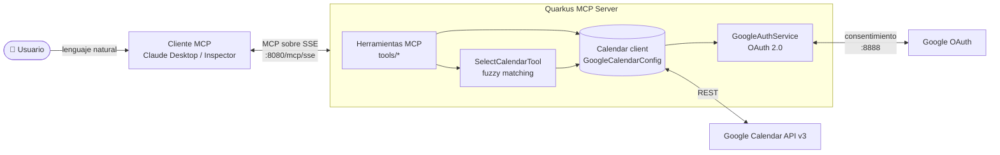

<div align="center">

# 📅 Google Calendar MCP Server

**Servidor MCP (Model Context Protocol) en Java + Quarkus que permite a un asistente de IA consultar y gestionar Google Calendar en lenguaje natural.**


</div>

---

## ✨ Qué hace

Este proyecto expone Google Calendar como un conjunto de **herramientas MCP** que cualquier cliente compatible (Claude Desktop, MCP Inspector, agentes propios…) puede descubrir e invocar. El modelo de lenguaje decide qué herramienta usar y con qué argumentos, y el servidor se encarga de la autenticación, la validación y las llamadas a la API de Google.

> 💬 *"Créame una reunión de equipo mañana de 10 a 11 en el calendario de trabajo"*
> → el asistente llama a `createEvent` → el evento aparece en Google Calendar.

## 🧠 Lo que demuestra este proyecto

| Área | Detalle |
|---|---|
| **Integración con IA (MCP)** | Servidor MCP sobre **SSE** con la extensión `quarkus-mcp-server-sse`. Cada herramienta lleva descripciones pensadas para que un LLM la use correctamente. |
| **Backend Java moderno** | Quarkus 3, **CDI** (`@Inject`, `@Produces`, `@Singleton`), empaquetado como *uber-jar*. |
| **Seguridad / OAuth 2.0** | Flujo *Authorization Code* con Google, acceso `offline` y persistencia de tokens para no reautenticar en cada arranque. Credenciales excluidas del control de versiones. |
| **Integración con APIs externas** | Cliente oficial de Google Calendar API v3: listado, creación y borrado (incluidos eventos recurrentes). |
| **Algoritmia aplicada** | Selección de calendario por nombre con **fuzzy matching** (coincidencia exacta → subcadena → distancia de **Levenshtein**), para tolerar errores tipográficos del usuario o del modelo. |
| **Robustez** | Validación de fechas ISO 8601 y gestión de errores uniforme que devuelve mensajes claros al cliente (entrada inválida, fallo de red, 404…). |

## 🏗️ Arquitectura



- **`GoogleAuthService`** gestiona el flujo OAuth 2.0: carga `credentials.json`, abre el navegador para el consentimiento y guarda los tokens en `tokens/`.
- **`GoogleCalendarConfig`** es un *producer* CDI que crea un único cliente `Calendar` autenticado e inyectable en todas las herramientas.
- **`tools/`** contiene las herramientas MCP; todas resuelven primero el calendario por nombre a través de `SelectCalendarTool`.

## 🛠️ Herramientas MCP disponibles

| Herramienta | Descripción |
|---|---|
| `selectCalendar` | Busca un calendario por nombre (con tolerancia a errores) y devuelve su ID y la lista de calendarios disponibles. |
| `listEvents` | Lista eventos de un calendario, con filtro opcional por texto y rango de fechas. |
| `createEvent` | Crea un evento (título, ubicación, descripción, inicio/fin ISO 8601, zona horaria) y devuelve su ID. |
| `deleteEventsByQuery` | Borra los eventos que coinciden con un texto de búsqueda (opcionalmente acotado por fechas). |
| `deleteEventsByDateRange` | Borra todos los eventos entre dos fechas. |
| `deleteRecurringEvent` | Borra un evento por ID, o una única instancia de un evento recurrente. |
| `clearAllEvents` | Vacía un calendario. ⚠️ Destructivo. |
| `hello` | Herramienta de prueba para comprobar la conexión cliente-servidor. |

## 🚀 Puesta en marcha

### Requisitos

- Java 17+
- Maven (o el wrapper incluido `./mvnw`)
- Una cuenta de Google y un proyecto en Google Cloud
- Un cliente MCP (p. ej. [MCP Inspector](https://github.com/modelcontextprotocol/inspector) o Claude Desktop)

### 1. Credenciales de Google

1. En [Google Cloud Console](https://console.cloud.google.com/), crea un proyecto nuevo.
2. **APIs y servicios → Biblioteca →** habilita **Google Calendar API**.
3. **APIs y servicios → Credenciales → Crear credenciales → ID de cliente de OAuth** (tipo *Aplicación de escritorio*). Configura la pantalla de consentimiento si te lo pide.
4. Descarga el JSON y guárdalo como `src/main/resources/credentials.json`.

### 2. Compilar y ejecutar

```bash
./mvnw clean package
java -jar target/calendar-mcp-1.0.0-SNAPSHOT-runner.jar
```

O en modo desarrollo, con recarga en caliente:

```bash
./mvnw quarkus:dev
```

En el primer arranque se abrirá el navegador para autorizar el acceso a tu calendario (redirección a `localhost:8888`). Los tokens se guardan en `tokens/` y no se vuelven a pedir.

### 3. Conectar un cliente MCP

El servidor escucha en `http://localhost:8080/mcp/sse`.

**MCP Inspector**

```bash
npx @modelcontextprotocol/inspector
```

Selecciona transporte **SSE** e introduce la URL anterior.

**Claude Desktop** (`claude_desktop_config.json`, usando el puente `mcp-remote`):

```json
{
  "mcpServers": {
    "google-calendar": {
      "command": "npx",
      "args": ["mcp-remote", "http://localhost:8080/mcp/sse"]
    }
  }
}
```

## 📁 Estructura del proyecto

```
src/main/
├── java/org/acme/
│   ├── GoogleAuthService.java       # Flujo OAuth 2.0 y persistencia de tokens
│   ├── GoogleCalendarConfig.java    # Producer CDI del cliente Calendar
│   └── tools/
│       ├── SelectCalendarTool.java  # Selección de calendario (Levenshtein)
│       ├── ListEventsTool.java      # Listado de eventos
│       ├── CreateEvent.java         # Creación de eventos
│       ├── DeleteEvent.java         # Borrado por texto, fechas, ID o completo
│       ├── Hello.java               # Prueba de conectividad
│       └── extra/                   # DTOs de respuesta
└── resources/
    ├── application.properties       # Puerto, logs, empaquetado
    └── credentials.json             # (no versionado) credenciales OAuth
```

## 🔭 Próximos pasos

- Tests unitarios y de integración con la API de Google *mockeada*.
- Paginación (`nextPageToken`) en listados y borrados masivos.
- Confirmación explícita antes de operaciones destructivas.
- Herramienta para **actualizar** eventos existentes.
- Flujo OAuth compatible con contenedores para desplegar con Docker.

## 🔒 Notas de seguridad

- `credentials.json` está en `.gitignore`: nunca lo subas al repositorio.
- Los tokens de acceso se guardan en local en `tokens/`.
- Las herramientas de borrado son irreversibles; úsalas primero sobre un calendario de pruebas.

## 👥 Autoría

Proyecto desarrollado en equipo como parte del **Reto 3: implementación del protocolo MCP**.

- **Dennis Adalbert** — [@adalbertdb](https://github.com/adalbertdb)
